# 风火轮打字 · Firewheel

> 风火轮转，键指生花 —— 一个中英文打字练习软件。
> 闲来无事,用deepseek来根据自己的需求写的一个打字练习软件.
> 深空夜色 + 火焰橙主题，纯 tkinter 自绘界面，单文件 exe，打开即用。
>
> 仓库地址：<https://github.com/xo1969/fhldzlx>
>
> [](https://github.com/xo1969/fhldzlx/actions/workflows/build.yml)


## 下载

- [最新版本 Releases](https://github.com/xo1969/fhldzlx/releases/latest)：Windows 10/11 单文件 exe，双击即用，无需安装 Python。
- 也可以拉源码自己打包：`packaging\build_exe.bat`；CI 在 Actions 里也会产出 exe 构建物。

## 三步开始

1. 从 Releases 下载 **`风火轮打字.exe`**（Windows 10/11），双击运行。
2. 首页点「立即练习」或挑一门课，直接敲键盘开始。
3. 练完自动弹出结算：速度、正确率、评级、是否破纪录，并写入历史统计。

> 没有 exe 时：双击 `启动风火轮打字.bat`（需要本机 Python 3.10+）；
> 或在项目目录执行 `python run.py`。

## 功能一览

### 练习
- **18 门课程**：英文（基准键位 / 字母 / 常用词 / 进阶词 / 句子 / 名言 / 文章 / 哪吒神话）、
  中文（单字 / 词组 / 成语 / 句子 / 古诗 / 文章 / 哪吒神话）、数字符号（数字 / 符号 / 代码）。
- **英文逐键判定**：打错的位置会标红闪一下；默认「严格模式」打错不前进，退格可修正。
- **中文逐行比对**：底部输入框输入当前高亮行，整行打对自动跳到下一行，兼容输入法整段上屏；
  也可「跳过本行」。
- **自定义文本**：首页「自定义文本」粘贴任意段落开始练，中英文混排也行。
- **虚拟键盘**：底部实时高亮下一个要按的键，并带手指分区配色。
- **代码练习换行**：代码课程按行显示，打完整行会自动进入下一行（按 Enter 也可以），不会卡在行尾。
- **自动跟随**：长文本练习时，光标接近底部会提前向下滚动，始终留出后面几行。
- **光标可换**：竖线 / 方框 / 下划线三种样式，可开关平滑移动，也可以换成系统里任意字体练习。
- 三种题量：短（约 1 分钟）/ 中（约 2 分钟）/ 长（约 3 分钟）。

### 背景音乐
- 播放条常驻底部：上一首 / 播放暂停 / 下一首 / 音量 / 进度线。
- 「播放列表」里可**添加音乐、添加整个文件夹**，支持 mp3 / wav / ogg / flac / m4a / wma；
  列表会记住，下次打开自动续上。
- 循环方式：列表循环 / 单曲循环 / 随机播放；播放到结尾自动切歌。
- 音频后端自动选择：pygame（支持音量）→ Windows MCI（wav/mp3）→ 静默；**没有声卡也不影响打字**。
- **按键音效**：设置里可开关，敲对一声轻响、敲错一声提示；音量独立可调。

### 统计
- 每局记录：时间、课程、模式、速度、正确率、评级。
- 汇总：练习次数、累计时长、平均速度、最佳速度、平均正确率。
- 速度趋势折线图、各类型平均速度对比、近 14 天练习量柱状图、历史记录表。
- 首页四张卡片显示今日练习 / 累计字数 / 平均速度 / 最佳速度。

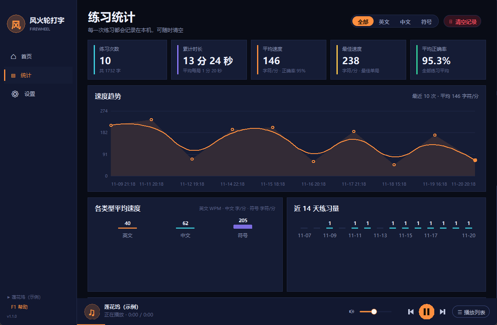

### 设置与帮助
- **界面缩放**：紧凑 / 标准 / 大 / 超大，整个界面的字号、间距、按钮一起变，立即生效；
  练习中也想改的话先退出本局，避免丢失本局进度。
- **练习字体 / 光标**：可换系统字体，光标可选竖线 / 方框 / 下划线，并可开关平滑移动。
- 界面圆角、滑杆、开关、横幅全部用 Pillow 超采样绘制，边缘做抗锯齿处理。
- 严格模式、每局长度、目标文字大小、虚拟键盘开关。
- 按键音效与音量、背景音乐音量、循环方式。
- 数据目录（一键打开）、清空全部记录、快捷键说明。
- 按 `F1` 或点侧边栏「F1 帮助」打开帮助浮层：练习方法 + 快捷键 + 数据位置。

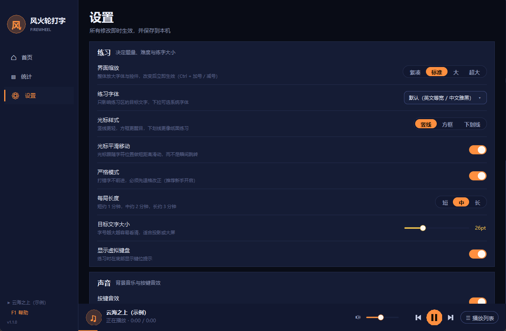


## 快捷键

| 按键 | 作用 |
| --- | --- |
| `Tab` / `F5` | 重开本局 |
| `Esc` | 返回首页 |
| `Backspace` | 英文模式退格修正 |
| `Ctrl+1 / 2 / 3` | 首页 / 统计 / 设置 |
| `Ctrl + 加号 / 减号` | 放大 / 缩小整个界面 |
| `Ctrl + 0` | 界面缩放恢复标准 |
| `Enter` | 代码练习：行末自动进入下一行，按 Enter 也可跳过 |
| `F1` | 打开帮助浮层 |

## 数据存放位置

设置与历史成绩保存在：`%LOCALAPPDATA%\FirewheelTyping\`

- `settings.json`：所有设置与音乐列表
- `history.db`：练习记录（SQLite）

删掉这个文件夹即可恢复出厂状态；设置页也有「清空全部记录」。

## 界面预览

| 英文练习 | 中文练习 |
| --- | --- |
| 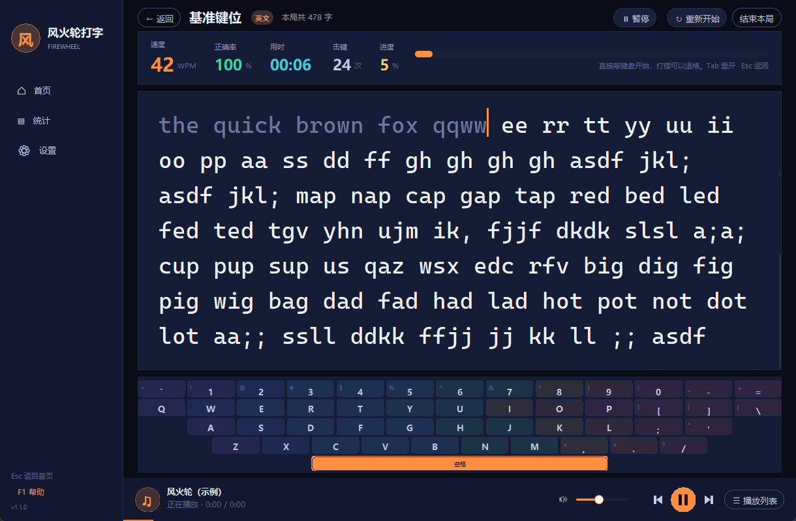 | 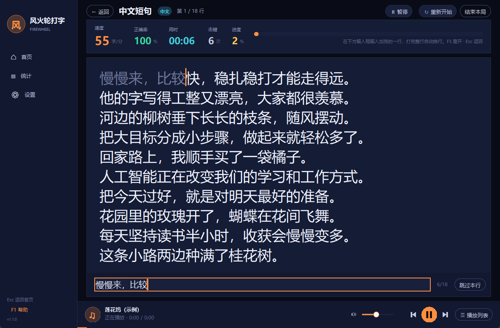 |

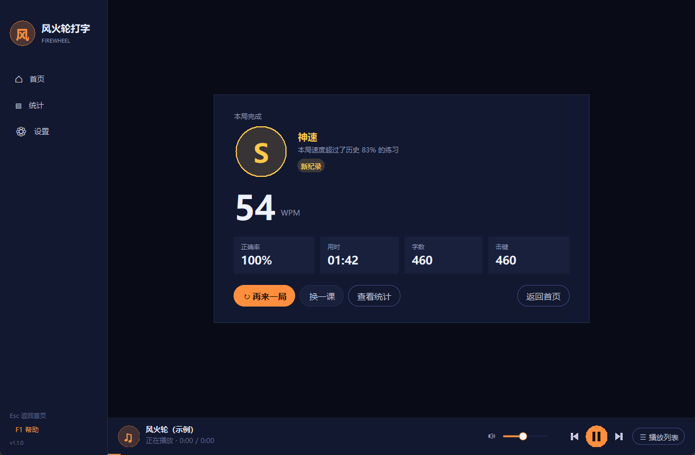

| 背景音乐播放列表 | 自定义文本 |
| --- | --- |
| 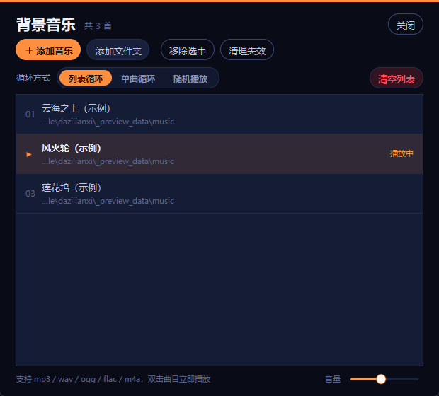 | 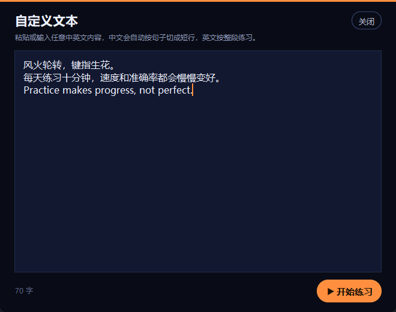 |

| 方框光标（代码练习） | 下划线光标（代码练习） |
| --- | --- |
| 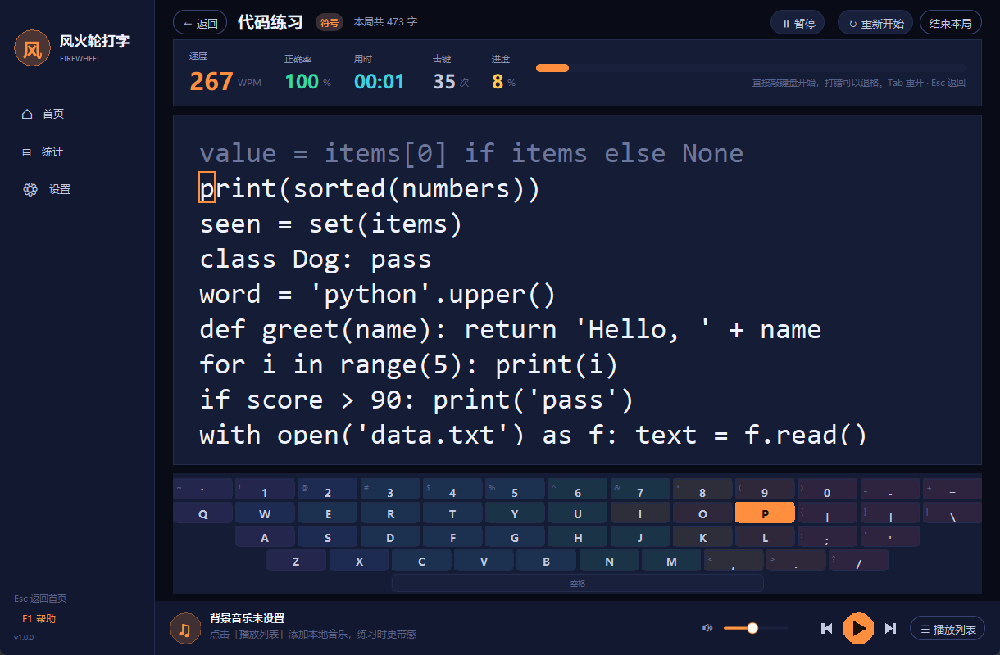 | 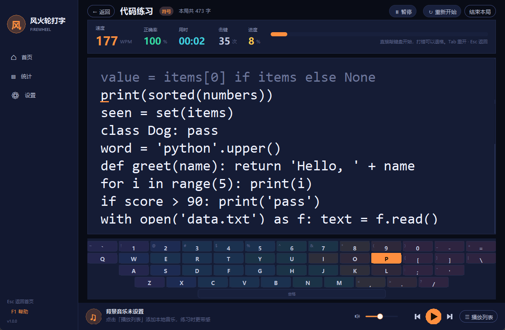 |

| 楷体 + 中文输入光标 | 自动换行后光标对齐 |
| --- | --- |
| 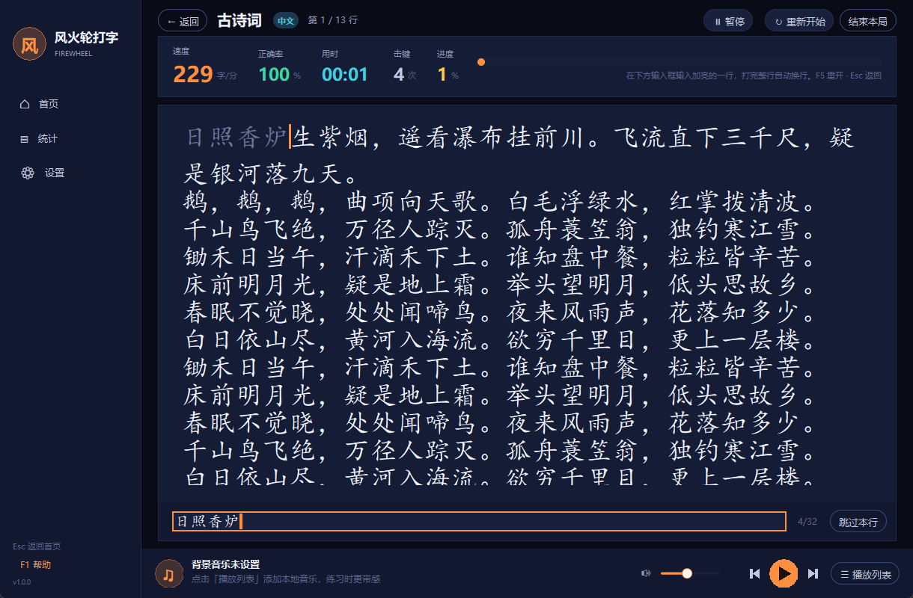 | 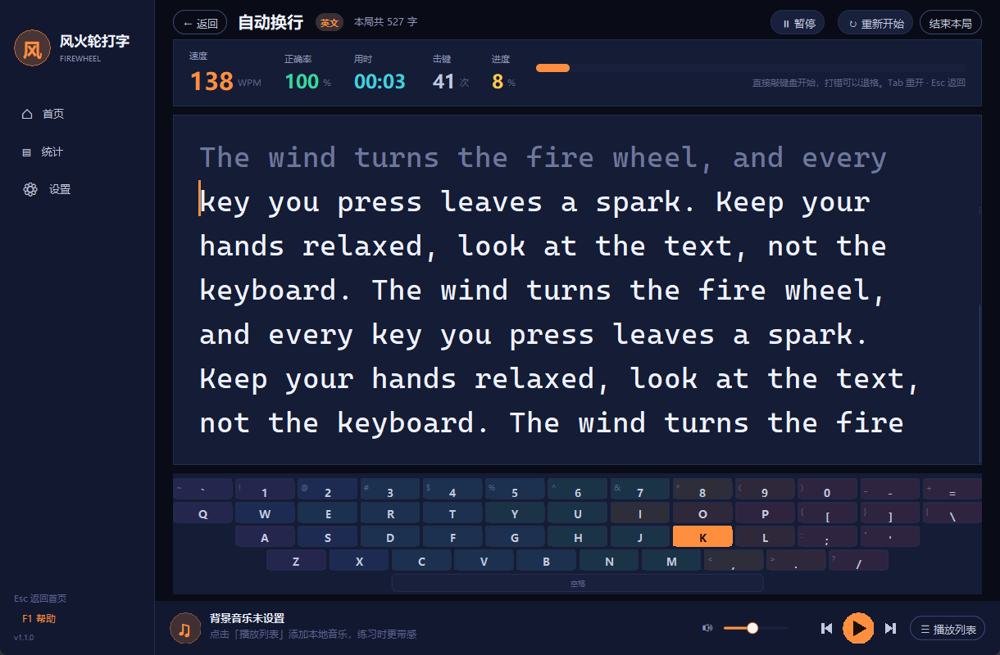 |

## 更新记录

- **v1.1.0（2026-11-20）**
  - 代码练习：每行末尾不再卡住，换行自动跳过、按 Enter 也能过；字数/速度不计换行。
  - 界面：按钮 / 滑杆 / 开关 / 标签 / 横幅改为 Pillow 超采样圆角，锯齿明显减少。
  - 光标：新增 竖线 / 方框 / 下划线 三种样式，可平滑移动；修复换行、软换行、自动滚动后光标停在上一位的问题。
  - 字体：练习字体可下拉更换，目标文本与中文输入框同步。
  - 打包体积因内置 Pillow 增至约 29.8 MB。
- **v1.0.0（2026-11-20）**：首个公开版本（中英文练习、背景音乐、统计、设置）。

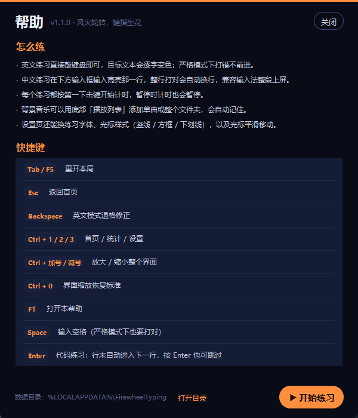

## 从源码运行 / 二次开发

```bat
git clone https://github.com/xo1969/fhldzlx.git
cd fhldzlx
pip install -r requirements.txt
python run.py
```

```text
app/
  main.py        主窗口、侧边栏、屏幕切换、音乐条、全局快捷键
  config.py      路径、默认设置、Settings 持久化
  theme.py       配色、字体、圆角绘制、ttk 暗色皮肤
  widgets.py     自绘控件：按钮、开关、滑杆、分段、卡片、图表、虚拟键盘
  engine.py      英文/中文练习会话与速度、正确率、评级计算
  content.py     语料组卷（按课程、题量、随机种子生成练习）
  content_data.py  语料库
  audio.py       背景音乐播放器（pygame / MCI 双后端）+ 按键音效
  music_ui.py    底部播放条与播放列表弹窗
  db.py          SQLite 历史记录
  screens/       home / practice / stats / settings 四个页面
tools/
  make_assets.py  生成 logo 与 ico
  screenshot.py   无污染截图（示例数据）
tests/
  smoke_test.py   无窗口逻辑自测
  gui_test.py     真实事件级界面流程自测
```

```bat
python tests\smoke_test.py     :: 引擎 / 数据 / 组卷
python tests\gui_test.py       :: 真实按键事件跑完整流程（会短暂弹窗）
python tools\screenshot.py     :: 重新生成 _shots 预览图
packaging\build_exe.bat        :: 重新打包 single-file exe
```

## 已知限制

- 中文练习依赖输入法，练习时请确保输入法为中文状态；逐行比对，不支持行内跳字修改。
- 字体下拉只列出系统里已安装的常见等宽/中文字体；没有 Pillow 时会退回无抗锯齿的绘制。
- 背景音乐音量在极少数老音频驱动上可能无效（MCI 后端），可改用 pygame（默认已安装）。
- 打包版首次启动需要解压，约 2~4 秒；之后秒开。

## 关于名字与来源

- 「风火轮打字」是原创的个人练习项目，界面、代码、语料均为本项目自己实现。
- 练习形式（课程分档、逐字判定、速度/正确率统计、历史记录）参考了打字练习软件的通用交互，
  但没有复制任何商业软件的界面素材、图标或文案。
- 视觉上的哪吒、风火轮、混天绫属于公共神话意象；本项目与「金山打字通」「哪吒打字」
  等任何商业产品均无关联，也不代表其官方或授权版本。

## 许可证

本项目以 [MIT License](LICENSE) 开源，Copyright (c) 2026 Cyrus.Sun。
